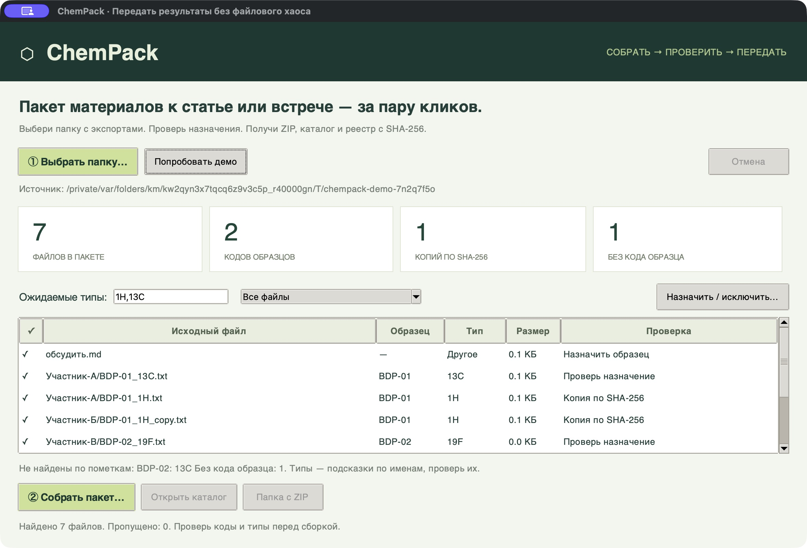

# ChemPack ⬡

**Небольшая утилита, чтобы собрать результаты к статье, встрече или передаче коллеге.**

Выбираешь папку с экспортами → проверяешь назначения файлов → получаешь ZIP с каталогом, реестром и контрольными суммами. Подходит для папки, которую синхронизирует Google Drive, или сохранённых из Telegram файлов.



**Начни здесь: [короткая инструкция на 2 минуты](START_HERE.md).**

## Запуск без установки библиотек

Нужен Python **3.11+**. Распакуй исходники и открой папку проекта.

- **macOS:** двойной щелчок по `Запустить.command` или команда `python3 -m chempack` в папке проекта.
- **Windows:** `Запустить.bat` или `py -3 -m chempack` в папке проекта.
- **Linux:** `python3 -m chempack`; для окна нужен установленный Tkinter, обычно пакет `python3-tk`.

Окно написано на Tkinter из стандартной библиотеки. Проверено на Python 3.14 / macOS. Для работы из терминала Tkinter не требуется. Интернет, аккаунт и API-ключи не нужны.

## Три действия

1. **«Выбрать папку»** — утилита найдёт подходящие файлы, вычислит SHA-256, предложит код образца и тип материала по имени. Сначала можно нажать **«Попробовать демо»**.
2. **Проверить таблицу.** Двойной щелчок по строке — исправить код и тип или исключить файл. Можно выделить несколько строк через Shift/Cmd/Ctrl и изменить их вместе. Совпадения содержимого и файлы без кода доступны отдельными фильтрами.
3. **«Собрать ZIP»** — выбрать папку назначения **вне исходной**. В новой папке появятся `ChemPack.zip`, `index.html`, `files.csv`, `chempack-manifest.json` и копии материалов по образцам и типам.

Передай команде **ChemPack.zip**. После распаковки открой `index.html`: в нём есть кликабельные ссылки на материалы, перечень отсутствующих пометок и точных копий. Сам каталог без соседних файлов не содержит вложения.

Фильтр **«Требуют проверки»** показывает включённые файлы с неясными назначениями или копиями. Поиск работает по пути, коду и типу. Щелчок в колонке **«В ZIP»** переключает включение файла. Для нескольких выделенных строк нажми пробел.

Разметку можно сохранить и загрузить как JSON. Сохранённый приложением файл содержит контрольные суммы, поэтому при загрузке изменённые исходники пропускаются. Этот JSON также подходит для `--assign`.

## Что экономит время

- Не нужно вручную перекладывать PDF, `.mnova`, таблицы, изображения, структуры и другие экспорты в папки образцов.
- По SHA-256 видно, что разные названия скрывают одно содержимое. **Все выбранные копии сохраняются:** одинаковое содержимое ещё не доказывает, что файл отнесён к правильному образцу.
- По выбранному чек-листу видно, какие **типы файлов не помечены** для каждого найденного кода. По умолчанию `1H,13C`; можно указать `1H,13C,19F,HRMS` или оставить поле пустым.
- При копировании повторно проверяется содержимое. Если исходный файл поменялся после сканирования, сборка остановится и предложит пересканировать папку.
- Одинаковые имена не перезаписываются: к имени копии добавляется суффикс. Исходная папка не изменяется.

## Имена и назначения

Примеры автоматических подсказок:

| Имя или относительный путь | Код | Тип |
| --- | --- | --- |
| `BDP-01_1H.pdf` | BDP-01 | 1H |
| `BDP_012_13C.txt` | BDP-012 | 13C |
| `BDP001_19F.mnova` | BDP001 | 19F |
| `sample_12/HRMS.csv` | 12 | HRMS |
| `BDP-02/COSY.pdf` | BDP-02 | 2D |
| `BDP-02_structure.cdxml` | BDP-02 | Структура |

Также распознаются 11B, 31P, UV-Vis, PL, IR и названия распространённых 2D-экспериментов. `BDP-01` и `BDP001` остаются разными кодами: утилита не решает, являются ли они одним веществом. При нескольких подходящих кодах назначение оставляется пустым. Простые числа в пути сами по себе не становятся номерами веществ, чтобы не путать образцы с частотой прибора, датой или номером эксперимента.

**Это организация файлов, не анализ их содержимого.** `.mnova` может содержать сразу несколько спектров: у него остаётся один назначенный тип, а содержимое не разбирается. Материал может быть неправильно подписан — проверь предложения до отправки. Чек-лист не знает о веществах, для которых вообще нет файлов, и не оценивает полноту научной характеризации.

Поддерживаются экспортированные документы, таблицы, изображения, спектральные тексты, файлы структур и ZIP. Сырые папки Bruker с `acqus` + `fid/ser` пропускаются, чтобы не разрушать их внутреннюю структуру; добавь такой эксперимент **готовым ZIP-архивом**. Вложенные ZIP не распаковываются. Скрытые, служебные файлы и символические ссылки пропускаются. Список пропусков входит в реестр.

Лимиты: 5000 подходящих файлов, 512 МБ на файл, 2 ГБ суммарно. Для копий и ZIP нужно около двойного размера выбранных файлов на диске. Не синхронизируй и не редактируй исходные файлы во время сборки.

## Из терминала

Установка пакета необязательна. Все команды запускаются из папки исходников.

```bash
# Создать отдельную папку синтетических примеров
python3 -m chempack demo demo-input

# Посмотреть назначения и совпадения без копирования
python3 -m chempack scan demo-input

# Собрать пакет в новую папку
python3 -m chempack pack demo-input --out demo-package --require 1H,13C
```

При необходимости создай `assignments.json`:

```json
[
  {"relative": "непонятное_имя.pdf", "sample": "BDP-03", "kind": "1H", "include": true},
  {"relative": "личные_заметки.txt", "include": false}
]
```

Применение: `python3 -m chempack pack project --assign assignments.json --out package`. Пути в назначениях должны точно соответствовать полю `relative` из команды `scan`. Можно менять отдельные поля; остальные сохраняются.

При желании установи команду `chempack` через `python3 -m pip install .`.

## Проверки

```bash
python3 -m unittest discover -s tests -v
```

Тесты проверяют распознавание названий, неполные наборы, точные копии, совпадающие имена, сохранность исходников, соответствие ZIP контрольным суммам, отказ при изменённом источнике, пропуск ссылок, отмену и сохранность существующей папки назначения.

Демо полностью синтетическое: это маленькие текстовые вложения для проверки работы утилиты, не экспериментальные спектры или результаты группы. Данные из Telegram/Drive в исходники не включены. В общем реестре используются относительные пути; абсолютный путь исходной папки не записывается. Потенциальные формулы в CSV экранируются апострофом; оригинальные значения остаются в JSON.

MIT License.
